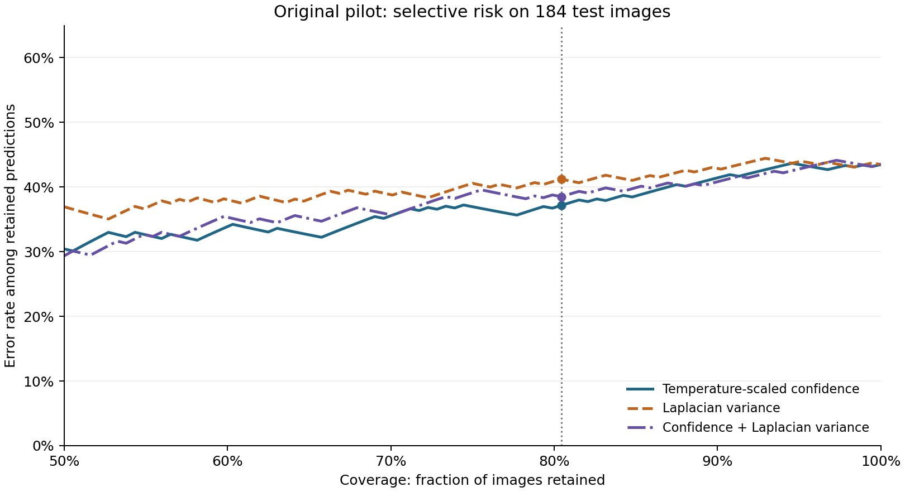
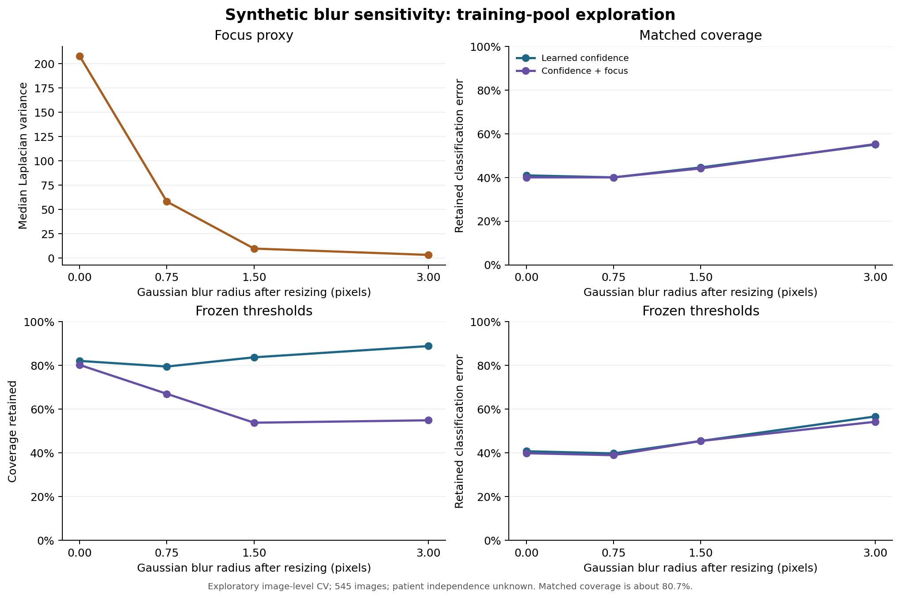
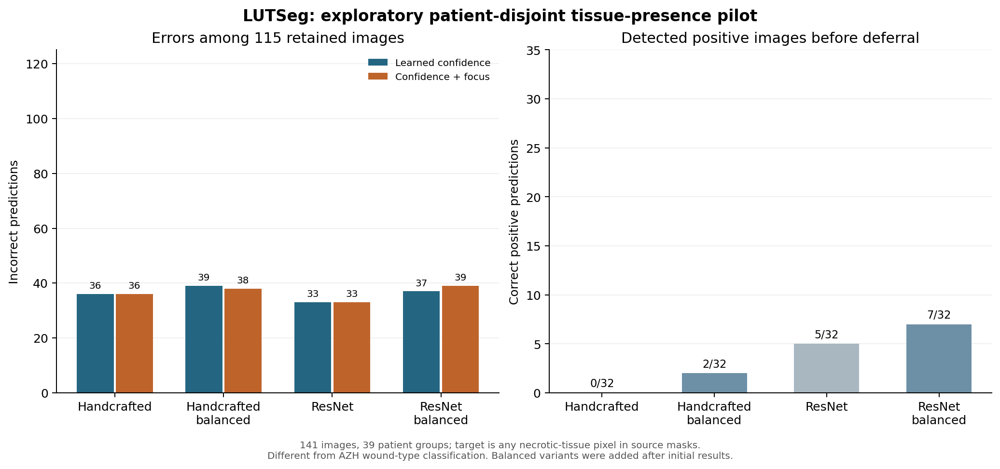

# Does image sharpness add to model confidence?

An exploratory, reproducible study of **selective classification** on wound images: a classifier can keep a prediction or defer it. The question is whether a simple focus proxy helps identify errors that a temperature-scaled confidence score misses.

**Project context:** research preparation by [Kamal Abu Qamar](https://github.com/kamalabuqamar20), motivated by GazaCare AI. The experimental implementation and analysis were developed with AI assistance. The code, fixed splits, aggregate outputs and limitations are available for review.

[Read the research brief](docs/RESEARCH_BRIEF.md) · [Proposed next study](docs/RESEARCH_PROPOSAL.md) · [Methods](docs/METHODS.md) · [Patient-data feasibility](docs/PATIENT_DATA_FEASIBILITY.md)

> **Research prototype:** the analysis is not clinically validated and must not be used to diagnose, triage or make treatment decisions.

## Why this question?

An image classifier may be confident even when an image is difficult to interpret. Calibration concerns agreement between confidence and average correctness, but images with the same confidence can still have different error rates across quality groups. A focus measurement may therefore add information—or it may primarily track image texture, wound category or acquisition conditions.

Laplacian variance has previously been used in wound-image quality feedback ([Zhang et al.](https://doi.org/10.2196/26149)). Confidence-calibrated selective prediction has also been studied in pressure-injury staging ([Lott et al.](https://pubmed.ncbi.nlm.nih.gov/42314450/)), and cross-dataset performance can deteriorate ([Choi et al.](https://pubmed.ncbi.nlm.nih.gov/42870149/)). The narrower question here is whether a focus proxy adds to confidence-based selection for wound-type predictions from unseen patients. We do not claim a new focus measure, a first application of selective prediction to wound images, or a comprehensive novelty review.

The pilot tests that question using one fixed classifier and the AZH wound-type data released by the University of Wisconsin–Milwaukee team. **AZH has four wound-type labels; it is not DFUC2021's infection/ischaemia task.** The original authors note that some patients contributed multiple images, so image-level splits cannot establish patient independence. [AZH source](https://github.com/uwm-bigdata/wound-classification-using-images-and-locations) · [Source paper](https://doi.org/10.1038/s41598-022-21813-0)

## Findings

The first pilot used the authors' test split. At the same number of retained images (**148 of 184**), the fixed classifier made:

| Selection rule | Retained errors | Retained error rate |
|---|---:|---:|
| Temperature-scaled confidence | 55 / 148 | 37.16% |
| Laplacian variance | 61 / 148 | 41.22% |
| Learned confidence + Laplacian variance | 57 / 148 | 38.51% |

The joint-minus-confidence difference was **+1.35 percentage points**. A paired, class-stratified image bootstrap gave an approximate 95% interval of **−0.69 to +4.07 points**, conditional on the fitted model and observed test class mix. This pilot does not establish an improvement from adding the focus proxy.



A later **five-fold, image-level** analysis within the original training pool gave a different small difference. At **440 of 545 images retained across the folds**, a learned confidence-only selector retained 180 errors; a like-for-like selector with the additional focus feature retained 176. This is descriptive: folds share training data, patient grouping was unavailable, and the follow-up was designed after the original result was visible. The original test archive was read for deduplication but was not scored in this follow-up.

These findings show why a single aggregate score is not enough. [Detailed results](docs/RESULTS.md) include per-class retention, class-reweighted risk and the fold-level comparison.

## Controlled blur follow-up

We applied four levels of synthetic Gaussian blur to the **same held-out images** in the five training-pool folds, keeping each fold's classifier, calibration and selectors fixed. At the strongest tested blur, retained error at matched 80.73% coverage was **55.00%** for learned confidence and **55.23%** for confidence plus focus. This exploratory comparison does not show an added benefit from the focus measure.

When thresholds chosen on clean calibration scores were held fixed instead, the two rules retained different fractions of the blurred images: **88.81%** for learned confidence and **54.86%** for the joint rule at that blur level. Their resulting error rates therefore describe different selected sets and review loads. The experiment is synthetic, image-level and not a test on independently identified patients. See the [protocol, results and limitations](docs/BLUR_SENSITIVITY.md).



## Pretrained features and patient-data feasibility

On the same image-level training-pool folds, we compared the handcrafted
baseline with a **frozen ImageNet-pretrained ResNet-18 encoder plus a fitted
logistic head**. On clean images, unfiltered accuracy was 302/545 (55.41%) for
the baseline and 380/545 (69.72%) for the pretrained-feature pipeline. At
matched 80.73% coverage, the pretrained pipeline retained 109 errors using
learned confidence alone and 114 using confidence plus focus. This is an
exploratory comparison of two complete pipelines on the same dataset; it does
not establish patient-independent or clinical performance. See the
[protocol and all blur conditions](docs/PRETRAINED_COMPARISON.md) and the
[comparison figure](figures/pretrained_comparison.png).

The overall rate hides substantial class differences in this exploratory
sample. Using ResNet features and the confidence-only rule on clean images,
35 of 69 retained pressure-wound predictions were errors, compared with 17 of
163 retained venous-wound predictions. These are wound-type groups, not
demographic groups, and the counts do not establish the cause or clinical
significance of the difference. The [class breakdown and fixed-threshold
results](docs/PRETRAINED_COMPARISON.md#class-level-and-fixed-threshold-results)
show the denominators and limits.

The later [held-out calibration audit](docs/CALIBRATION_AUDIT.md) measures the
base classifiers' probabilities on the same image-level folds. For the frozen
ResNet-feature pipeline, top-label ECE after temperature scaling was 0.0650 on
clean images and 0.2272 at the strongest synthetic blur. ECE depends on binning
and sample size; the audit does not establish calibration for new patients.
NLL, multiclass Brier scores and bin counts are reported alongside it.

In a further [split-sensitivity check](docs/SPLIT_SENSITIVITY.md), we repeated
the clean-image comparison across five image-level split seeds. For frozen
ResNet features, the joint rule retained the same number of errors in two
splits and more in three; it retained fewer in none. These splits reuse the
same images and overlapping training pools, so they are descriptive, not
independent replications or confidence intervals.

We also audited public WoundsDB case-description metadata to investigate
patient grouping. The pinned table contains 188 photo records, 47 case
identifiers and 79 case-day pairs; its diabetic-foot label has only **two case
groups**. Its source labels do not map directly to all four AZH classes. We did
not train or externally validate a model on WoundsDB. See the
[patient-data feasibility audit](docs/PATIENT_DATA_FEASIBILITY.md).

## Separate patient-grouped tissue-presence pilot

To test patient-grouped methodology without relying on unavailable AZH
identifiers, we performed a separate exploratory experiment on
[LUTSeg](https://huggingface.co/datasets/ksanchez84/LUTSeg): 141 images from
39 patient groups. The target is a binary image-level label derived from the
source's necrotic-tissue mask metadata; it is **not** the AZH four-class
wound-type task. Five outer folds keep each patient's images out of the
corresponding model, temperature and selector fitting sets.

For unweighted frozen ResNet features, learned confidence and learned
confidence plus focus each retained **33 errors among 115 images**. Before
deferral, the classifier correctly identified only **5 of 32 positive images**.
This makes class-specific performance a critical limitation. The
[full patient-grouped pilot](docs/LUTSEG_PATIENT_PILOT.md) reports an
always-absent reference, balanced-loss sensitivity checks, fixed thresholds,
per-class counts, a source-mask audit and the small-sample limitations. It is not external
validation of the AZH model or evidence of clinical utility.



## AZH study design

| Stage | What was done |
|---|---|
| Data audit | Inspected 930 released images; one byte-identical surgical image crossed the train/test split. The training copy was removed, leaving 929 images across all six released categories. |
| Classification task | Kept the four wound types: diabetic, pressure, surgical and venous. Normal-skin and background categories were not used for model fitting. |
| Base classifier | Trained L2 multinomial logistic regression on fixed local gradient and RGB histogram features from 128×128 images. |
| Original selection rules | Compared maximum temperature-scaled class probability, Laplacian variance, and a learned score using both. |
| Evaluation | Compared error among retained images at matched coverage; also reported risk-coverage curves, class-specific results and class-reweighted risk. |
| Follow-up | Compared confidence-only and confidence-plus-focus selectors fitted on the same inner training data in five image-level folds. |

Ground-truth wound classes are used for evaluation, not as selector inputs at prediction time. Class reweighting does not by itself equalise coverage inside each class or establish a causal effect; an additional true-label-matched diagnostic is reported for analysis only. See [methods and assumptions](docs/METHODS.md).

## Reproduce

Python **3.12** is the supported environment. Commands run from the repository root. Windows PowerShell:

```powershell
py -3.12 -m venv .venv
.\.venv\Scripts\Activate.ps1
python -m pip install -r requirements.txt
python -m unittest discover -s tests -v
```

macOS / Linux:

```bash
python3.12 -m venv .venv
source .venv/bin/activate
python -m pip install -r requirements.txt
python -m unittest discover -s tests -v
```

To download the two pinned archives **only after reviewing the upstream data terms**, reproduce the original pilot and run the training-pool follow-up:

```bash
python run_azh_pilot.py --download --data-dir data/raw --output reproduced/original
python run_train_cv.py --data-dir data/raw --output reproduced/train_cv
python run_blur_sensitivity.py --data-dir data/raw --output reproduced/blur_sensitivity
python verify_results.py --original reproduced/original --train-cv reproduced/train_cv --blur reproduced/blur_sensitivity
python make_figures.py --original reproduced/original --train-cv reproduced/train_cv --output reproduced/figures
python make_blur_figures.py --results reproduced/blur_sensitivity --output reproduced/figures
```

On PowerShell, the same `python` commands work after activation. If the verified `Train.zip` and `Test.zip` are already in `data/raw`, omit `--download`. Each archive is checked against a pinned SHA-256 hash; no image is written into the results. The included `results/` and `figures/` are the actual aggregate outputs from these runs. The comparison script checks the reproduced JSON against those outputs; tiny floating-point differences are allowed, while changed retained counts are reported.

The included GitHub Actions workflow runs synthetic tests on a push or pull request; it does not download the dataset or reproduce the image experiments. Check the [Actions page](https://github.com/kamalabuqamar20/azh-selective-classification/actions) for the status of the relevant commit.

For optional pretrained features and the metadata-only patient audit, follow
the separate instructions in [PRETRAINED_COMPARISON.md](docs/PRETRAINED_COMPARISON.md)
and [PATIENT_DATA_FEASIBILITY.md](docs/PATIENT_DATA_FEASIBILITY.md). PyTorch is
an optional dependency and is not needed for the standard offline tests.

## Repository guide

- [`run_azh_pilot.py`](run_azh_pilot.py) — original test-split pilot, preserved for reproduction.
- [`run_train_cv.py`](run_train_cv.py) and [`study_utils.py`](study_utils.py) — later training-pool sensitivity analysis and validated helpers.
- [`run_blur_sensitivity.py`](run_blur_sensitivity.py) and [`make_blur_figures.py`](make_blur_figures.py) — paired synthetic-blur analysis and its aggregate figure.
- [`run_pretrained_comparison.py`](run_pretrained_comparison.py) and [`make_pretrained_figure.py`](make_pretrained_figure.py) — optional frozen ResNet-18 comparison and aggregate figure.
- [`run_calibration_audit.py`](run_calibration_audit.py) and [`make_calibration_figure.py`](make_calibration_figure.py) — held-out probability diagnostics and aggregate reliability plots.
- [`run_split_sensitivity.py`](run_split_sensitivity.py) and [`make_split_figure.py`](make_split_figure.py) — repeated image-level split comparison and descriptive plot.
- [`run_lutseg_patient_pilot.py`](run_lutseg_patient_pilot.py), [`lutseg_data.py`](lutseg_data.py), [`audit_lutseg_masks.py`](audit_lutseg_masks.py) and [`make_lutseg_figure.py`](make_lutseg_figure.py) — separate patient-grouped binary tissue-presence pilot with verified optional downloads and a source-mask audit.
- [`audit_woundsdb.py`](audit_woundsdb.py) — aggregate-only patient-group feasibility audit; no WoundsDB model evaluation.
- [`patient_splits.py`](patient_splits.py) — group-disjoint split helpers, used in the separate LUTSeg pilot.
- [`verify_results.py`](verify_results.py) and [`make_figures.py`](make_figures.py) — output comparison and figure generation.
- [`results/`](results/) and [`figures/`](figures/) — aggregate numeric outputs and plots.
- [`tests/`](tests/) — synthetic checks for splits, metrics, input validation and calibration caveats.
- [`docs/METHODS.md`](docs/METHODS.md), [`docs/RESULTS.md`](docs/RESULTS.md), [`docs/BLUR_SENSITIVITY.md`](docs/BLUR_SENSITIVITY.md), [`docs/DATA_AND_LIMITATIONS.md`](docs/DATA_AND_LIMITATIONS.md) and [`docs/FUTURE_WORK.md`](docs/FUTURE_WORK.md) — research reasoning and scope.

## Limits and data rights

The AZH analysis uses one small dataset with a handcrafted-feature classifier and a frozen pretrained-feature comparison. The focus proxy is sensitive to texture and resolution; AZH patient and acquisition-source IDs were not available for grouping. Exact matching cannot rule out near-duplicate images or repeated patients. The original test result was already inspected, and the follow-up is exploratory, not a preregistered confirmation. The AZH calibration audit is pooled across image-level folds and does not establish calibration within patient or demographic groups. The separate LUTSeg pilot uses patient groups for a different, small and clinically specific task; it is not external validation of the AZH model.

No patient images or individual records are included in this repository. Image rights and access terms remain with the upstream provider; review those terms before reuse or redistribution. No licence has yet been specified for this repository's code.

## Selected references

1. Anisuzzaman et al. (2022), [Multi-modal wound classification using wound image and location](https://doi.org/10.1038/s41598-022-21813-0).
2. Guo et al. (2017), [On Calibration of Modern Neural Networks](https://proceedings.mlr.press/v70/guo17a.html).
3. Geifman and El-Yaniv (2017), [Selective Classification for Deep Neural Networks](https://papers.nips.cc/paper_files/paper/2017/hash/4a8423d5e91fda00bb7e46540e2b0cf1-Abstract.html).
4. Jones et al. (2021), [Selective Classification Can Magnify Disparities Across Groups](https://arxiv.org/abs/2010.14134).
5. Zhang et al. (2021), [Wound Image Quality and Real-Time Quality Feedback](https://doi.org/10.2196/26149).
6. Ovadia et al. (2019), [Evaluating Predictive Uncertainty under Dataset Shift](https://proceedings.neurips.cc/paper/2019/hash/8558cb408c1d76621371888657d2eb1d-Abstract.html).
7. Bengio and Grandvalet (2004), [Variance of K-Fold Cross-Validation](https://jmlr.org/papers/v5/grandvalet04a.html).
8. Sanchez et al. (2026), [LUTSeg: A Longitudinal Multi-Expert Dataset for Ulcer Tissue Segmentation](https://papers.miccai.org/miccai-2026-sat/ISIC_019.html).
