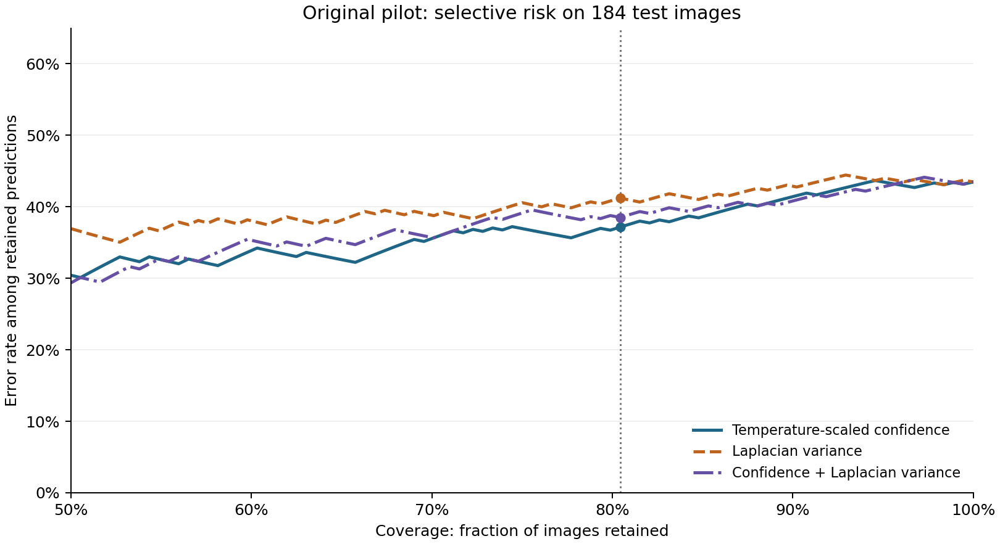

# Does image sharpness add to model confidence?

An exploratory, reproducible study of **selective classification** on wound images: a classifier can keep a prediction or defer it. The question is whether a simple focus proxy helps identify errors that a temperature-scaled confidence score misses.

**Project context:** research preparation by [Kamal Abu Qamar](https://github.com/kamalabuqamar20), motivated by GazaCare AI. The experimental implementation and analysis were developed with AI assistance. The code, fixed splits, aggregate outputs and limitations are available for review.

> **Research prototype:** the analysis is not clinically validated and must not be used to diagnose, triage or make treatment decisions.

## Why this question?

An image classifier may be confident even when an image is difficult to interpret. Calibration concerns agreement between confidence and average correctness, but images with the same confidence can still have different error rates across quality groups. A focus measurement may therefore add information—or it may primarily track image texture, wound category or acquisition conditions.

The pilot tests that question using one fixed classifier and the AZH wound-type data released by the University of Wisconsin–Milwaukee team. **AZH has four wound-type labels; it is not DFUC2021's infection/ischaemia task.** The original authors note that some patients contributed multiple images, so image-level splits cannot establish patient independence. [AZH source](https://github.com/uwm-bigdata/wound-classification-using-images-and-locations) · [Source paper](https://doi.org/10.1038/s41598-022-21813-0)

## Findings

The first pilot used the authors' test split. At the same number of retained images (**148 of 184**), the fixed classifier made:

| Selection rule | Retained errors | Retained error rate |
|---|---:|---:|
| Temperature-scaled confidence | 55 / 148 | 37.16% |
| Laplacian variance | 61 / 148 | 41.22% |
| Learned confidence + Laplacian variance | 57 / 148 | 38.51% |

The joint-minus-confidence difference was **+1.35 percentage points**. A paired, class-stratified image bootstrap gave an approximate 95% interval of **−0.69 to +4.07 points**, conditional on the fitted model and observed test class mix. This pilot does not establish an improvement from adding the focus proxy.



A later **five-fold, image-level** analysis within the original training pool gave a different small difference. At **440 of 545 images retained across the folds**, a learned confidence-only selector retained 180 errors; a like-for-like selector with the additional focus feature retained 176. This is descriptive: folds share training data, patient grouping was unavailable, and the follow-up was designed after the original result was visible. The original test archive was read for deduplication but was not scored in this follow-up.

These findings show why a single aggregate score is not enough. [Detailed results](docs/RESULTS.md) include per-class retention, class-reweighted risk and the fold-level comparison.

## Study design

| Stage | What was done |
|---|---|
| Data audit | Inspected 930 released images; one byte-identical surgical image crossed the train/test split. The training copy was removed, leaving 929 images across all six released categories. |
| Classification task | Kept the four wound types: diabetic, pressure, surgical and venous. Normal-skin and background categories were not used for model fitting. |
| Base classifier | Trained L2 multinomial logistic regression on fixed local gradient and RGB histogram features from 128×128 images. |
| Original selection rules | Compared maximum temperature-scaled class probability, Laplacian variance, and a learned score using both. |
| Evaluation | Compared error among retained images at matched coverage; also reported risk-coverage curves, class-specific results and class-reweighted risk. |
| Follow-up | Compared confidence-only and confidence-plus-focus selectors fitted on the same inner training data in five image-level folds. |

Ground-truth wound classes are used for evaluation, not as selector inputs at prediction time. Class reweighting does not by itself equalise coverage inside each class or establish a causal effect; an additional true-label-matched diagnostic is reported for analysis only. See [methods and assumptions](docs/METHODS.md).

## Reproduce

Python **3.12** is the supported environment. Commands run from the repository root. Windows PowerShell:

```powershell
py -3.12 -m venv .venv
.\.venv\Scripts\Activate.ps1
python -m pip install -r requirements.txt
python -m unittest discover -s tests -v
```

macOS / Linux:

```bash
python3.12 -m venv .venv
source .venv/bin/activate
python -m pip install -r requirements.txt
python -m unittest discover -s tests -v
```

To download the two pinned archives **only after reviewing the upstream data terms**, reproduce the original pilot and run the training-pool follow-up:

```bash
python run_azh_pilot.py --download --data-dir data/raw --output reproduced/original
python run_train_cv.py --data-dir data/raw --output reproduced/train_cv
python verify_results.py --original reproduced/original --train-cv reproduced/train_cv
python make_figures.py --original reproduced/original --train-cv reproduced/train_cv --output reproduced/figures
```

On PowerShell, the same four `python` commands work after activation. If the verified `Train.zip` and `Test.zip` are already in `data/raw`, omit `--download`. Each archive is checked against a pinned SHA-256 hash; no image is written into the results. The included `results/` and `figures/` are the actual aggregate outputs from these runs. The comparison script checks the reproduced JSON against those outputs; tiny floating-point differences are allowed, while changed retained counts are reported.

The included GitHub Actions workflow runs synthetic tests on a push or pull request; it does not download the dataset. **It has been tested locally, but has not yet run on GitHub.**

## Repository guide

- [`run_azh_pilot.py`](run_azh_pilot.py) — original test-split pilot, preserved for reproduction.
- [`run_train_cv.py`](run_train_cv.py) and [`study_utils.py`](study_utils.py) — later training-pool sensitivity analysis and validated helpers.
- [`verify_results.py`](verify_results.py) and [`make_figures.py`](make_figures.py) — output comparison and figure generation.
- [`results/`](results/) and [`figures/`](figures/) — aggregate numeric outputs and plots.
- [`tests/`](tests/) — synthetic checks for splits, metrics, input validation and calibration caveats.
- [`docs/METHODS.md`](docs/METHODS.md), [`docs/RESULTS.md`](docs/RESULTS.md), [`docs/DATA_AND_LIMITATIONS.md`](docs/DATA_AND_LIMITATIONS.md) and [`docs/FUTURE_WORK.md`](docs/FUTURE_WORK.md) — research reasoning and scope.

## Limits and data rights

This is one small dataset and one lightweight model. The focus proxy is sensitive to texture and resolution; patient and acquisition-source IDs were not available for grouping. Exact matching cannot rule out near-duplicate images or repeated patients. The original test result was already inspected, and the follow-up is exploratory, not a preregistered confirmation.

No patient images or individual records are included in this repository. Image rights and access terms remain with the upstream provider; review those terms before reuse or redistribution. No licence has yet been specified for this repository's code.

## Selected references

1. Anisuzzaman et al. (2022), [Multi-modal wound classification using wound image and location](https://doi.org/10.1038/s41598-022-21813-0).
2. Guo et al. (2017), [On Calibration of Modern Neural Networks](https://proceedings.mlr.press/v70/guo17a.html).
3. Geifman and El-Yaniv (2017), [Selective Classification for Deep Neural Networks](https://papers.nips.cc/paper_files/paper/2017/hash/4a8423d5e91fda00bb7e46540e2b0cf1-Abstract.html).
4. Jones et al. (2021), [Selective Classification Can Magnify Disparities Across Groups](https://arxiv.org/abs/2010.14134).
5. Zhang et al. (2021), [Wound Image Quality and Real-Time Quality Feedback](https://doi.org/10.2196/26149).
