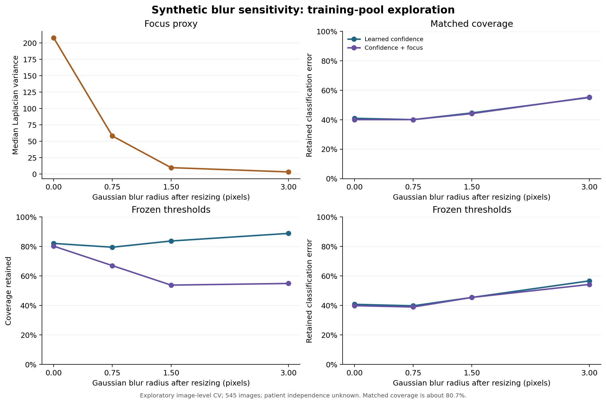

# Controlled blur sensitivity: exploratory protocol

## Purpose and scope

This follow-up asks how a frozen wound-type classifier and its selection rules
respond when exactly the same held-out images are blurred. It was designed after
the original pilot and the training-pool analysis were inspected; it is not a
preregistered or independent confirmation. The experiment uses the original
training pool only. The original test archive is read to remove exact
cross-split duplicates, but its images are not scored in this analysis.

## Protocol

1. Reuse the same 545 deduplicated training-pool wound images, five image-level
   outer folds and clean-data inner partitions as the existing follow-up. Patient
   and source identifiers are unavailable.
2. For each outer fold, fit one classifier, temperature and confidence-only and
   confidence-plus-focus selectors on clean inner data. Freeze all components.
3. Resize each held-out image to 128 by 128 pixels, then apply Pillow's
   `GaussianBlur` at radii 0, 0.75, 1.5 and 3.0 pixels. Radius 0 is unblurred.
   Pillow approximates Gaussian blur with extended box filters; the radii are
   experimental parameters at this resolution, not clinically rated severity
   levels. The model sees the same held-out images and labels at every radius.
4. Report two distinct analyses:
   - **Matched coverage:** rank scores within each held-out fold and blur level,
     keeping `ceil(0.8 * fold_size)` predictions for each rule. This is a
     retrospective ranking comparison and uses the held-out score distribution.
   - **Fixed thresholds:** choose one threshold per rule and fold from clean
     calibration-set scores, targeting 80% retention there. Freeze these
     thresholds for clean and blurred held-out images. Held-out coverage is
     allowed to change. Ties can make calibration-set retention exceed the
     target. The same calibration data are used to fit temperature and select
     thresholds; no held-out scores or labels are used to set them.
5. Report median focus, unfiltered error, retained error and coverage, plus
   aggregate prediction and deferral changes for paired images. Do not save
   individual images or individual-level predictions.

## Interpretation limits

Synthetic uniform blur on a fixed 128-pixel image is a controlled stress test,
not naturally acquired motion blur, an acquisition-site shift, a clinician's
image-usability rating, or a claim about unseen patients. Image texture,
resizing, noise and background can affect the Laplacian proxy. The current
classifier is a lightweight image-level baseline. Results remain exploratory:
patient overlap is unknown, folds share training data, the original pilot was
already inspected, and the severity levels have not been clinically validated.
No clinical, causal, fairness or population-level claim follows from this test.

Pillow reference: <https://pillow.readthedocs.io/en/stable/reference/ImageFilter.html#PIL.ImageFilter.GaussianBlur>.

## Observed results

These are pooled counts from the five held-out image folds. Matched coverage
retains 88 of 109 images in each fold: 440 of 545 overall (80.73%). Thresholds
for the fixed-threshold columns were selected separately for each fold using
that fold's clean calibration scores.

| Blur radius at 128 px | Median focus | Confidence retained error, matched | Confidence + focus retained error, matched | Confidence fixed-threshold coverage | Confidence + focus fixed-threshold coverage |
|---:|---:|---:|---:|---:|---:|
| 0.00 | 207.52 | 40.91% (180/440) | 40.00% (176/440) | 82.02% (447/545) | 80.18% (437/545) |
| 0.75 | 57.89 | 40.00% (176/440) | 40.00% (176/440) | 79.45% (433/545) | 66.97% (365/545) |
| 1.50 | 9.58 | 44.55% (196/440) | 44.09% (194/440) | 83.67% (456/545) | 53.76% (293/545) |
| 3.00 | 3.07 | 55.00% (242/440) | 55.23% (243/440) | 88.81% (484/545) | 54.86% (299/545) |



At matched coverage, the retained-error differences between the two learned
selection rules are small in this run; synthetic blur does not establish an
added benefit from focus. At radius 3.0 the fixed-threshold rules retain very
different fractions of the images. The confidence rule retains 484 images with
274 errors (56.61%); the joint rule retains 299 with 162 errors (54.18%).
Those error rates describe different selected sets and different review loads,
so their difference is not a matched-coverage comparison.

The median focus proxy falls as the chosen blur radius increases. The base
classifier's unfiltered error rate changes from 243/545 (44.59%) on clean images
to 311/545 (57.06%) at radius 3.0. On the same 545 images, 234 predicted labels
change at radius 3.0: 114 predictions change from correct to incorrect and 46
from incorrect to correct; some others change between incorrect classes. The
unfiltered error count at radius 0.75 is 236, so this run does not show a
strictly monotonic error increase over all radii. These are descriptive counts,
not estimates of clinical performance or independent patient outcomes.

The machine-readable aggregate results and all fold-level counts are in
[`results/blur_sensitivity`](../results/blur_sensitivity/). The zero-radius
matched-coverage counts exactly match the existing training-pool analysis.

## Reproduce

After reviewing the original data terms and obtaining the verified archives:

```bash
python run_blur_sensitivity.py --data-dir data/raw --output reproduced/blur_sensitivity
python make_blur_figures.py --results reproduced/blur_sensitivity --output reproduced/figures
python verify_results.py --original reproduced/original --train-cv reproduced/train_cv --blur reproduced/blur_sensitivity
```

The last command also verifies the existing original and five-fold analyses;
run the README reproduction commands for those outputs first. `--download`
can be added to the first command to fetch the two pinned archives.
