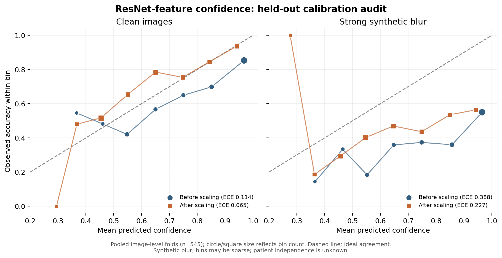

# Exploratory held-out calibration audit

## What was tested?

We assessed the base wound-type classifier's class probabilities before and
after temperature scaling, using the existing handcrafted-feature and frozen
ResNet-18 pipelines. This audit was added after the original pilot, blur and
pretrained results were inspected. It is exploratory, not preregistered and
not an independent confirmation.

The same 545 original training-pool images and five image-level outer folds are
used throughout. In each fold, model fitting and temperature fitting use
separate clean inner subsets. Only the held-out fold is evaluated. The fitted
temperature is then held fixed for the clean image and three synthetically
blurred versions of that same image. The original test archive is read only
for exact deduplication; no original-test predictions are evaluated here.
The image-level folds do not establish patient independence.

Each metric is calculated after pooling all five sets of held-out predictions.
This is a pooled out-of-fold description of several fitted models, not the
performance of one fixed model on a new patient cohort. For the pretrained
pipeline, the encoder is frozen, while a logistic classification head and
temperature are fitted separately within each fold.

## Measures

- **Top-label ECE:** divide the maximum predicted class probability into ten
  equal-width bins, then take the sample-weighted absolute difference between
  mean confidence and observed correctness in each nonempty bin. The final
  bin includes confidence 1.0. Empty bins contribute zero. Smaller is better
  for this empirical diagnostic, but the value depends on binning and sample
  size; it does not establish group-wise or individual calibration.
- **Negative log likelihood (NLL):** mean negative log probability assigned
  to the true class, with the probability clipped below at `1e-15`.
- **Multiclass Brier score:** mean, across images, of the sum over four classes
  of `(predicted probability - one-hot target)²`. We use the unscaled
  multiclass convention. Smaller NLL and Brier score are better as probability
  scores, but neither is a pure measure of calibration alone.

This audit concerns the **base classifier's probabilities**. It does not
assess whether the separate learned correctness selector is calibrated.

## Recorded results

All values below use the 545 pooled held-out images in the relevant condition.
The complete four-radius results and bin counts are in
[`results/calibration_audit`](../results/calibration_audit/).

| Pipeline | Blur radius | ECE before → after | NLL before → after | Brier before → after |
|---|---:|---:|---:|---:|
| Handcrafted | 0.00 | 0.1856 → 0.0485 | 1.3565 → 1.1064 | 0.6442 → 0.5908 |
| Handcrafted | 3.00 | 0.3631 → 0.1831 | 2.2155 → 1.4198 | 0.8856 → 0.7448 |
| Frozen ResNet features | 0.00 | 0.1141 → 0.0650 | 0.9426 → 0.8479 | 0.4536 → 0.4466 |
| Frozen ResNet features | 3.00 | 0.3879 → 0.2272 | 2.2415 → 1.5087 | 0.9014 → 0.7706 |



In the frozen ResNet-feature comparison, the pooled top-label ECE after
temperature scaling was 0.0650 on clean images and 0.2272 at the strongest
synthetic blur. At that blur level, mean confidence was 64.29% while accuracy
was 41.83%. These are descriptive sample averages, not calibrated guarantees.
Positive temperature scaling does not change the predicted class within a
fold; in this audit, the code checks that class predictions remain unchanged.

The comparison of two ECE values is sensitive to binning and sparse bins,
and folds share training data. No patient-level uncertainty interval or
clinical conclusion is supported. Synthetic blur does not represent all real
image-quality problems. Calibration under one set of acquisition conditions
cannot be presumed to transfer to another; see [Ovadia et al. (2019)](https://proceedings.neurips.cc/paper/2019/hash/8558cb408c1d76621371888657d2eb1d-Abstract.html).

## Reproduce

After installing the baseline and optional PyTorch requirements, and after
reviewing the upstream data terms:

```bash
python run_calibration_audit.py --data-dir data/raw --weights data/models/resnet18-f37072fd.pth --download-weights --output reproduced/calibration_audit
python verify_results.py --calibration reproduced/calibration_audit
python make_calibration_figure.py --results reproduced/calibration_audit --output reproduced/figures
```

Add `--download-data` only if the pinned AZH archives are not already present.
The optional weights download uses the official PyTorch checkpoint and checks
its SHA-256 hash. CPU extraction can take several minutes. Only aggregate
results and plots are written; no images, embeddings or individual predictions
are saved by this audit. See [PRETRAINED_COMPARISON.md](PRETRAINED_COMPARISON.md)
for the optional dependency installation and feature preprocessing.

References: [Guo et al. (2017)](https://proceedings.mlr.press/v70/guo17a.html),
[Ovadia et al. (2019)](https://proceedings.neurips.cc/paper/2019/hash/8558cb408c1d76621371888657d2eb1d-Abstract.html),
[scikit-learn metric definitions](https://scikit-learn.org/1.8/modules/model_evaluation.html).
