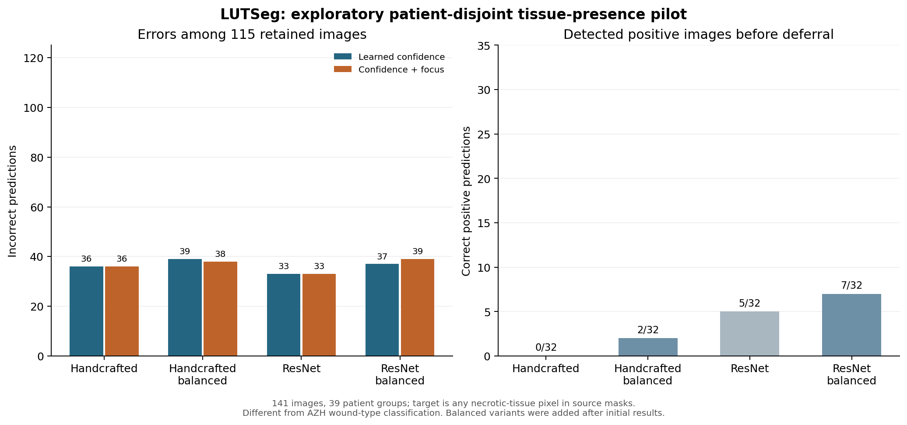

# Patient-grouped LUTSeg pilot: a separate tissue-presence task

## Question and scope

Can confidence-based selection, with or without a focus proxy, identify fewer
errors on images from patients excluded from the corresponding fitting
partitions? This is an exploratory **binary tissue-presence** experiment on
LUTSeg, not the AZH four-class wound-type task. It does not externally validate
the AZH model or answer whether focus improves AZH predictions for unseen
patients.

The [LUTSeg dataset](https://huggingface.co/datasets/ksanchez84/LUTSeg) and
[MICCAI workshop paper](https://papers.miccai.org/miccai-2026-sat/ISIC_019.html)
describe 141 longitudinal images from 39 pseudonymized patients with
leprosy-related ulcers. The source is released under CC BY 4.0; cite the
dataset and its creators when reusing it.

We create an image-level binary **reference label** from the source
`classes_present` metadata: label 4 (necrotic tissue) listed means `present`,
otherwise `absent`. This represents the presence of any source-annotated
class-4 pixels; there is no minimum area threshold. The pilot script relies on
the publisher's metadata. A separate audit checked all 141 source masks against
the metadata classes and image dimensions; this does not establish that the
annotations are clinically correct. This derived label is not a separately
adjudicated binary clinical diagnosis. Small or disputed annotations can affect it.

The release contains 32 `present` images from 16 patient groups and 109
`absent` images from 36 groups. Thirteen patients have both labels at
different visits, so the group totals overlap. Images from the same patient
are never split across fitting and held-out sets within a fold.

The decoded-pixel audit found no exactly identical images within or between
patient groups. It cannot rule out near-duplicates, related views or errors in
the source's patient grouping. In a post-hoc [mask-area audit](../results/lutseg_mask_audit/),
28 of the 32 positive images had at least 1% of annotated wound pixels assigned
class 4; the median among positive images was 11.18%. These area thresholds
describe this dataset only and are not clinical thresholds or new training labels.

## Design

- Pool the source's 111 training and 30 validation images for a **new,
  exploratory** five-fold group-disjoint cross-validation. Each held-out fold
  contains 7–9 patient groups. This is not the source paper's original split.
- Within each outer training pool, use five patient-grouped inner folds:
  three fit the classifier, one fits temperature and selection thresholds,
  and one fits the correctness selectors. The code checks every pair of
  fitting and held-out patient sets for overlap.
- Compare the original handcrafted image features and frozen ImageNet
  ResNet-18 features with fitted logistic heads. Each pipeline has an
  unweighted version. Class-balanced loss versions were added **after the
  initial unweighted results were inspected** and are post-hoc sensitivity
  analyses. Frozen ImageNet pretraining was not audited for patient overlap.
- Compare maximum temperature-scaled confidence, a learned confidence-only
  correctness score, and a like-for-like learned score adding Laplacian
  variance. At matched coverage, each fold ranks its own held-out images,
  retaining `ceil(0.8 × fold size)`: **115 of 141 images (81.56%)** overall.
  Selected sets can differ. Thresholds fitted on calibration images are also
  evaluated separately, where achieved coverage varies.
- Report image-weighted retained error, per-class counts and the mean of
  within-patient retained error rates, excluding patients for whom every image
  was deferred and reporting their count. Patients may contribute different
  numbers of images and may appear in both source-label groups across visits.

## Results: class imbalance matters

These are pooled held-out predictions from the five patient-disjoint folds.
The constant `always absent` comparator has **109/141 (77.30%) accuracy** but
detects **0/32 positive images**. It is a fixed reference, not a useful
clinical model. The two image classifiers also miss most positive images:

| Pipeline | Unfiltered accuracy | Correct positive images / 32 |
|---|---:|---:|
| Handcrafted | 95/141 (67.38%) | 0/32 (0.00%) |
| Handcrafted, class-balanced | 88/141 (62.41%) | 2/32 (6.25%) |
| Frozen ResNet features | 99/141 (70.21%) | 5/32 (15.63%) |
| Frozen ResNet features, class-balanced | 94/141 (66.67%) | 7/32 (21.88%) |

At matched 81.56% image coverage, the retained-error counts were:

| Pipeline | Raw scaled confidence | Learned confidence | Learned confidence + focus |
|---|---:|---:|---:|
| Handcrafted | 31/115 | 36/115 | 36/115 |
| Handcrafted, class-balanced | 39/115 | 39/115 | 38/115 |
| Frozen ResNet features | 31/115 | 33/115 | 33/115 |
| Frozen ResNet features, class-balanced | 33/115 | 37/115 | 39/115 |

The learned one-feature selector and learned two-feature selector are the
like-for-like comparison; maximum scaled confidence is reported as an
additional untrained selector. For the unweighted ResNet-feature pipeline,
the two learned rules have the same overall error count, but the selected
images and class-specific counts can differ. In that confidence-only rule,
23 of 27 retained `present` images were incorrect. This is a major limitation
of the pilot, not evidence for clinical use.



With thresholds fixed from inner calibration scores, the unweighted ResNet
confidence-only and joint learned selectors retained 116/141 and 115/141
images respectively, with 33/116 and 35/115 errors. These are **different
coverages and selected sets**; they are not the matched-coverage comparison.
Full aggregate, per-class and fold counts are in
[`results/lutseg_patient_pilot`](../results/lutseg_patient_pilot/).

## Interpretation and reproducibility

The patient-disjoint grouping is a real improvement in evaluation design for
this separate task, but the sample is small, longitudinal and clinically
specific. The groups and training sets are not independent across folds;
these results supply no patient-level confidence interval, external-site
validation, or evidence of clinical benefit. The experiment was designed
after AZH results and LUTSeg metadata were inspected and was not registered in
advance. The balanced variants are explicitly post-hoc. No individual
patient, image, embedding or prediction is written to the result files.

Install the baseline and optional pretrained requirements as described in
[PRETRAINED_COMPARISON.md](PRETRAINED_COMPARISON.md), then:

```bash
python run_lutseg_patient_pilot.py --data-dir data/LUTSeg --weights data/models/resnet18-f37072fd.pth --download-data --download-weights --output reproduced/lutseg_patient_pilot
python audit_lutseg_masks.py --data-dir data/LUTSeg --download-data --output reproduced/lutseg_mask_audit
python verify_results.py --patient-pilot reproduced/lutseg_patient_pilot --mask-audit reproduced/lutseg_mask_audit
python make_lutseg_figure.py --results reproduced/lutseg_patient_pilot --output reproduced/figures
```

Dataset and weight downloads are explicit opt-ins. The script verifies the
pinned source revision, metadata and manifest hashes, and each source image's
hash. Images, masks and patient-group metadata stay in the local data
directory, which is ignored by Git; only aggregates and the figure are
provided here. The RGB files require approximately 106 MB, the masks about
2 MB and the official checkpoint about 45 MB. CPU processing may take several
minutes.
