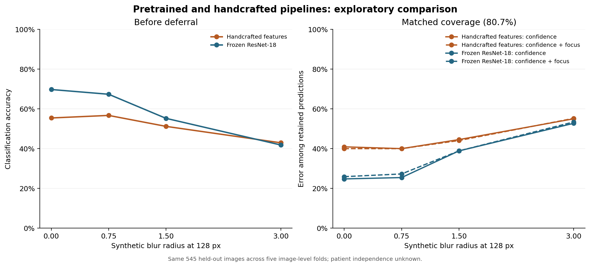

# Frozen pretrained-feature comparison

## Question and status

Does the previously observed behaviour of confidence and focus also appear
when the fixed-feature classifier uses an ImageNet-pretrained ResNet-18 encoder
instead of handcrafted gradient and colour histograms? This follow-up was
designed after the original and blur results were inspected. It is exploratory,
not a preregistered comparison or independent confirmation.

## Protocol

- Use the same 545 deduplicated training-pool images, five image-level outer
  folds, inner partitions, selector fitting and seeds as the existing blur
  analysis. The original test archive is read for exact deduplication only; no
  original-test predictions are scored. Patient and source identifiers are
  unavailable.
- The comparison baseline is the existing 128-by-128 handcrafted
  gradient/RGB feature pipeline plus a standardised multinomial logistic
  regression classifier. The new pipeline takes the same resized 128-by-128
  clean or blurred image, upsamples it to 224 by 224, applies ImageNet
  normalisation and extracts a 512-dimensional representation from a frozen
  ImageNet-1K ResNet-18. An identically specified logistic regression is fitted
  on clean inner training features. The encoder is not fine-tuned. This custom
  full-frame resizing is not the checkpoint's standard resize-and-centre-crop
  transform; it preserves the baseline's 128-pixel information and view.
- Both pipelines use the same image-derived 128-by-128 Laplacian variance,
  temperature scaling and learned one-feature versus two-feature correctness
  selectors. All fitted components are trained on clean inner data and frozen
  across the four blur conditions.
- Report matched-coverage retained error and the separate fixed-threshold
  coverage/error behaviour, with fold-level and class-level counts. The same
  image folds do not establish independence at patient level. The models
  differ in representation and preprocessing; this compares pipelines and
  does not isolate a causal effect of architecture alone.
- The ImageNet weights and the pinned archive hashes are checked. No clinical
  image, individual-level prediction, embedding or checkpoint is included in
  the repository. Gaussian blur is artificial and is not a clinical quality
  label or natural cross-site validation.

## Observed comparison

Each row pools the same five image-level held-out folds. At matched coverage,
each selection rule retains 440 of 545 images (80.73%). Lower error is better;
the selected sets may differ between rules and pipelines.

| Blur radius at 128 px | Handcrafted unfiltered errors / 545 | Frozen ResNet unfiltered errors / 545 | Handcrafted confidence errors / 440 | ResNet confidence errors / 440 | Handcrafted confidence + focus errors / 440 | ResNet confidence + focus errors / 440 |
|---:|---:|---:|---:|---:|---:|---:|
| 0.00 | 243 | 165 | 180 | 109 | 176 | 114 |
| 0.75 | 236 | 178 | 176 | 112 | 176 | 120 |
| 1.50 | 266 | 244 | 196 | 171 | 194 | 171 |
| 3.00 | 311 | 317 | 242 | 232 | 243 | 235 |



On unblurred images, unfiltered accuracy was **302/545 (55.41%)** for the
handcrafted pipeline and **380/545 (69.72%)** for frozen ResNet features with
the fitted logistic head. At radius 3.00, their unfiltered error counts were
311 and 317 respectively; strong blur reduced accuracy for both. This is a
descriptive comparison on one dataset, not evidence of performance on new
patients or a clinical result.

At matched coverage, the joint rule retained **114 errors versus 109** for
confidence alone on the clean ResNet-feature experiment; it did not show an
added benefit from focus there. Different folds share training data, and the
protocol was chosen after earlier results were visible, so the observed
differences should not be treated as independent replications or as proof of
a general absence of benefit.

With fixed thresholds at the strongest blur, ResNet-feature confidence and
joint rules retained 84.22% and 70.64% respectively. These describe different
selected sets and review burdens; their retained error rates must not be
interpreted as a matched-coverage comparison. Full aggregate and fold counts
are in [`results/pretrained_comparison`](../results/pretrained_comparison/).

## Class-level and fixed-threshold results

The following clean-image counts use the same pretrained-feature experiment.
Each class is defined by the source label; the total class counts sum to 545,
and each rule retains 440 images overall. The selected images can differ.

| True wound type | Images | Confidence: retained | Confidence: errors / retained | Confidence + focus: retained | Confidence + focus: errors / retained |
|---|---:|---:|---:|---:|---:|
| Diabetic | 139 | 107 | 25/107 (23.36%) | 107 | 27/107 (25.23%) |
| Pressure | 100 | 69 | 35/69 (50.72%) | 73 | 39/73 (53.42%) |
| Surgical | 121 | 101 | 32/101 (31.68%) | 96 | 31/96 (32.29%) |
| Venous | 185 | 163 | 17/163 (10.43%) | 164 | 17/164 (10.37%) |

Coverage and error differ by wound type even when total coverage is matched.
These descriptive comparisons do not identify a cause, establish statistical
significance, or measure demographic fairness. Images may share patients,
categories are clinically heterogeneous, and the class denominators are small.

Using each fold's fixed threshold fitted on clean development scores gives a
different operational view from re-ranking the held-out pool at 80% coverage:

| ResNet-feature rule | Blur radius | Retained / 545 | Errors / retained |
|---|---:|---:|---:|
| Confidence only | 0.00 | 429 (78.72%) | 101/429 (23.54%) |
| Confidence only | 3.00 | 459 (84.22%) | 256/459 (55.77%) |
| Confidence + focus | 0.00 | 413 (75.78%) | 99/413 (23.97%) |
| Confidence + focus | 3.00 | 385 (70.64%) | 217/385 (56.36%) |

At the strongest synthetic blur, the fixed confidence threshold retained more
images than on clean data even though its retained error rate increased. This
is a stress-test observation for these fitted models, not an estimate of natural
clinical blur or a guarantee about deployment. Different thresholds and blur
conditions retain different images, so their risk rates are not a
matched-coverage comparison.

Each fold fits a temperature on a separate clean calibration subset. A later
exploratory [held-out calibration audit](CALIBRATION_AUDIT.md) reports NLL,
multiclass Brier score and top-label ECE before and after scaling, together with
the bin counts and sample-size limitations. Temperature scaling alone does not
establish that probabilities are well calibrated in every group or setting.

## Reproduction

Use Python 3.12 and the pinned baseline dependencies. Install CPU PyTorch in the
same environment separately:

```bash
python -m pip install -r requirements-pretrained.txt --index-url https://download.pytorch.org/whl/cpu
python run_pretrained_comparison.py --data-dir data/raw --weights data/models/resnet18-f37072fd.pth --download-weights --output reproduced/pretrained_comparison
python make_pretrained_figure.py --baseline results/blur_sensitivity --pretrained reproduced/pretrained_comparison --output reproduced/figures
python verify_results.py --pretrained reproduced/pretrained_comparison
```

The data archives must already be available, or add `--download-data` after
reviewing their original terms. The weights are downloaded from the official
PyTorch URL only when `--download-weights` is supplied, and checked by SHA-256.
This script uses CPU and can take longer than the baseline. Versions and the
checkpoint hash are recorded in the aggregate output. Results can vary slightly
across numerical libraries; compare counts and reported metrics carefully.

Reference: <https://docs.pytorch.org/vision/0.21/models/generated/torchvision.models.resnet18.html>.
