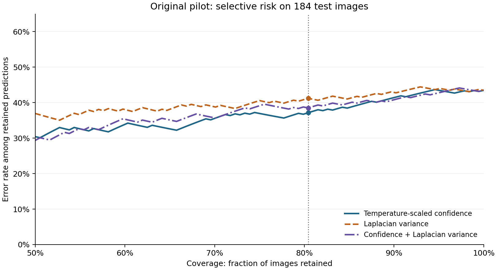
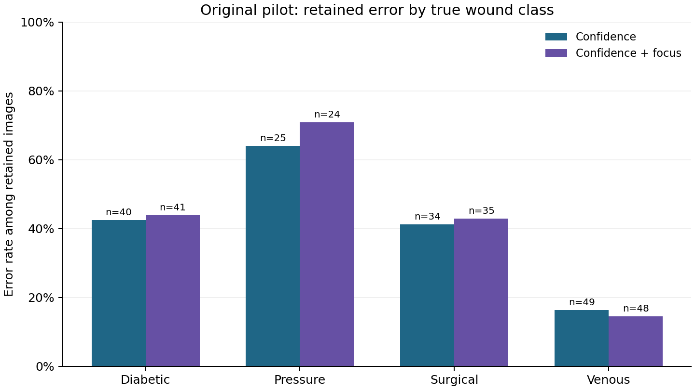
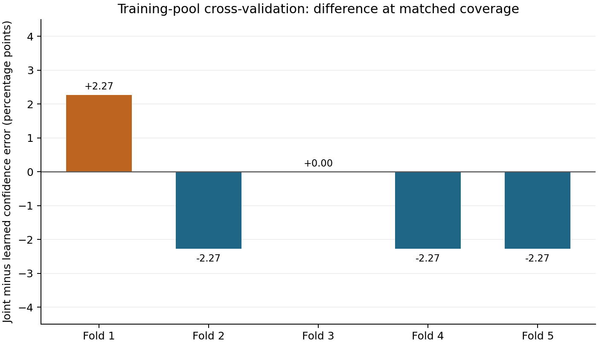

# Results and interpretation

All figures and tables below are generated from the checked-in aggregate outputs. Lower retained error is better for the same coverage. The same classifier is evaluated under different selection rules; the retained images need not be identical.

## Original test-split pilot

Before any deferral, the classifier was correct on **104 of 184 images (56.52%)**. For nominal 80% coverage, each rule retained **148 images (80.43%)**:

| Rule | Errors / retained | Retained error | Class-standardised error |
|---|---:|---:|---:|
| Temperature-scaled confidence | 55 / 148 | 37.16% | 37.35% |
| Laplacian variance | 61 / 148 | 41.22% | 41.62% |
| Confidence + Laplacian variance | 57 / 148 | 38.51% | 38.76% |

The unstandardised joint-minus-confidence difference is **+1.35 percentage points**, with an approximate paired class-stratified image-bootstrap interval of **−0.69 to +4.07 points**. The class-standardised difference is **+1.41 points**, with an interval of **−1.35 to +4.93 points**. Both are conditional exploratory intervals; neither accounts for patient clustering or refitting. They include zero, so they do not settle whether the difference would persist.

The evaluation-only matched-within-class diagnostic retains 149 images because of rounding within classes: confidence retains **55 errors**, and the joint score **58**. Since class labels are used to allocate retention, this diagnostic cannot be used as an operational selector.

### Class-specific context

The confidence rule retained 25 of 34 pressure-wound images, with 16 errors among those retained. The joint rule retained 24 of 34, with 17 errors. These small denominators make class-specific estimates unstable, but the contrast demonstrates why average retained error does not describe every class.

On this test split, 10-bin expected calibration error was 0.198 before and 0.062 after temperature scaling; negative log likelihood was 1.306 and 1.078, respectively. These are estimates from one sample. A lower binned calibration error does not imply calibration within each wound class, focus level, patient population or acquisition source.

## Five-fold training-pool sensitivity analysis

This follow-up was specified after viewing the original pilot. Each of the 545 training-pool wound images appears in one outer test fold; each fold separately retains 88 of 109 images. Across folds:

| Rule | Errors / retained | Retained error | Class-standardised error |
|---|---:|---:|---:|
| Temperature-scaled confidence | 180 / 440 | 40.91% | 41.39% |
| Laplacian variance | 192 / 440 | 43.64% | 43.71% |
| Learned confidence only | 180 / 440 | 40.91% | 41.39% |
| Learned confidence + focus | 176 / 440 | 40.00% | 40.47% |

All five learned confidence-only selectors had positive confidence slopes in this run, so their rankings matched direct confidence within each fold. That relationship is an observed property of these fits, not a guarantee.

| Outer fold | Learned confidence errors | Confidence + focus errors | Joint minus confidence |
|---|---:|---:|---:|
| 1 | 34 | 36 | +2 |
| 2 | 35 | 33 | −2 |
| 3 | 30 | 30 | 0 |
| 4 | 41 | 39 | −2 |
| 5 | 40 | 38 | −2 |

The aggregate difference is **−0.91 percentage points** in the training-pool analysis, while the original test pilot's difference was **+1.35 points**. They use different fitted models and samples; the signs alone do not demonstrate a reproducible benefit or harm. The five models share training data and may include images from the same patient, so the folds must not be treated as independent patient-level replications.

## Interpretation

The measured differences are small relative to the uncertainty and the unfiltered error rate. They motivate testing a conditional hypothesis with patient-level grouping, prespecified thresholds and an external acquisition source. They do not support clinical claims, establish a new state-of-the-art result or show that image focus is irrelevant in other settings.

The original dated report remains at [ORIGINAL_PILOT.md](ORIGINAL_PILOT.md). Machine-readable tables are in [`results/original`](../results/original/) and [`results/train_cv`](../results/train_cv/).
