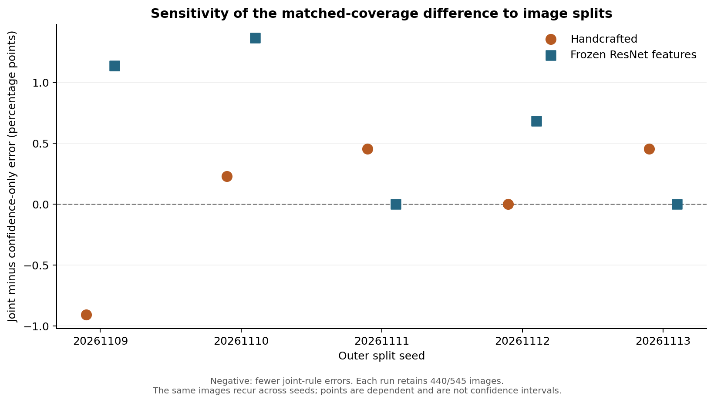

# Sensitivity to image-level split assignment

## Purpose and limits

The original exploratory training-pool follow-up used one five-fold
image-level partition. We subsequently repeated the clean-image comparison
using five fixed outer-split seeds: `20261109` through `20261113`. The seed
list and comparisons are fixed in the script for reproduction, but this
follow-up was designed after earlier results were seen; it was not
preregistered.

Each seed produces five stratified image-level folds of the same 545
deduplicated training-pool images. Both pipelines use identical outer folds.
Within each fold, separate clean subsets fit the classifier, temperature and
one- and two-feature correctness selectors. The selectors rank held-out
images separately within each fold. Each policy retains 440/545 images after
pooling the five folds, or 80.73% coverage. The original test archive is used
for exact deduplication only and is not scored.

The same images and overlapping training pools recur across seeds, and patient
identifiers are unavailable. These are **not five independent patient
studies**. The ranges below describe sensitivity to these particular image
partitions; they are not confidence intervals, statistical significance tests,
or measurements of generalisation to unseen patients. See [Bengio and
Grandvalet (2004)](https://jmlr.org/papers/v5/grandvalet04a.html) for the
difficulty of estimating cross-validation variance.

## Recorded clean-image results

All entries are retained errors out of 440 images. Lower is better, although
the selected images may differ between rules and pipelines.

| Outer seed | Handcrafted: confidence | Handcrafted: confidence + focus | ResNet: confidence | ResNet: confidence + focus |
|---|---:|---:|---:|---:|
| 20261109 | 180 | 176 | 109 | 114 |
| 20261110 | 181 | 182 | 113 | 119 |
| 20261111 | 187 | 189 | 121 | 121 |
| 20261112 | 179 | 179 | 130 | 133 |
| 20261113 | 194 | 196 | 114 | 114 |



For handcrafted features, adding focus had fewer retained errors in one split,
the same number in one, and more in three. For frozen ResNet features, it had
the same number in two splits and more in three. The paired difference
`joint risk - confidence-only risk` ranged from **−0.91 to +0.45 percentage
points** for the handcrafted pipeline and **0.00 to +1.36 points** for the
ResNet-feature pipeline. This exploratory check does not show a consistent
benefit from the additional feature; it also cannot rule out benefits in
other datasets or settings.

Full counts and fold-level summaries are in
[`results/split_sensitivity`](../results/split_sensitivity/). A lower total
error in a retained set does not imply the same images were retained, or a
causal effect of the focus feature.

## Reproduce

After installing the baseline and optional PyTorch requirements, and reviewing
the upstream data terms:

```bash
python run_split_sensitivity.py --data-dir data/raw --weights data/models/resnet18-f37072fd.pth --download-weights --output reproduced/split_sensitivity
python verify_results.py --split-sensitivity reproduced/split_sensitivity
python make_split_figure.py --results reproduced/split_sensitivity --output reproduced/figures
```

Add `--download-data` only if the pinned archives are absent. Feature
extraction currently computes the same four blur variants as the existing
comparison, although this check evaluates only the clean variant. CPU
extraction can take several minutes. Outputs contain aggregate counts only.
See [PRETRAINED_COMPARISON.md](PRETRAINED_COMPARISON.md) for installation and
feature preprocessing.
